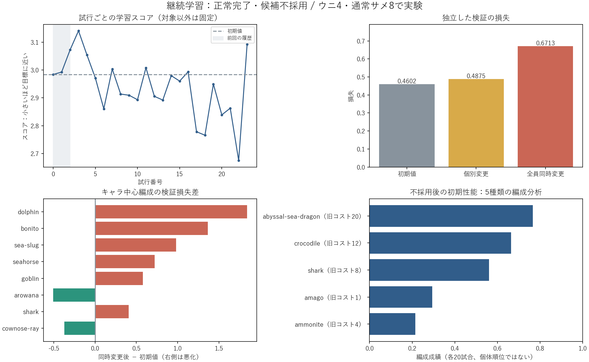

# 継続学習の結果（2026-10-13）

この文書はGPT-6によって書かれています。

対象：`LearningLab\runs\continued-exploratory-search-20261013`。正常完了、約85分15秒。終了は日本時間17:29。新規評価13,920試合＋独立編成分析280試合、計14,200試合。前回の3候補・2更新を引き継ぎ、21候補を追加し、全30種類の分布を累計23回更新しました。

**採用条件を満たさず、候補は不採用。HP・攻撃力・防御力をゲームへ適用していません。**

| 指標（低いほど設計目標に近い） | 初期値 | 選択候補 |
|---|---:|---:|
| キャラ別最良値を集めた学習スコア（変更罰則込み） | 2.9838 | 2.1005 |
| 対象以外を固定する個別検証損失 | 0.4602 | 0.4875 |
| 全30種類を同時変更した検証損失 | 0.4602 | 0.6713 |

学習スコアは約29.6%下がりましたが、個別検証は約5.9%、同時検証は約45.9%増加しました。採用条件は同時検証の平均損失が初期値以下であることなので不採用です。46%は損失の増加率であり、勝率や強さが46%低下したという意味ではありません。

損失は「設計した強弱の目標帯からのずれ」です。勝率を全員最大化する目的ではありません。対象中心編成の上限は1.0で、そこでの突出した強さには上限罰則をかけていません。混合編成には目標帯が残り、強すぎても弱すぎても損失になります。

## 学習が進んだ部分と、まだ確認できない部分

変更候補は24種類、初期値を選んだのは6種類です。生成分布の中心・広がりは全30種類で更新されました。実際に評価した試行の平均スコアの最良は試行22の2.6748、最終試行は3.0920です。キャラ別最良値を集めた2.1005は、同じ一回の対戦で全員同時に測った学習スコアではありません。継続的に下がり続けて収束したとは言えません。

学習・個別検証では、対象キャラ以外の味方は初期値に固定します。各キャラで最良だった値を合成し、最後の同時検証で初めて味方全体を変えます。そのため、個別の候補がよくても組み合わせがよいとは限りません。今回は個別検証でも悪化しているため、組み合わせだけでなく、学習相手への偏りも疑われます。学習相手の中心種はアンモナイト・通常サメの2種類、検証はゴブリン・通常サメ・クロコダイル・深海シードラゴンの4種類です。混成の相方には30種類を使います。

## 同時検証での主な変化

| キャラ中心の編成 | 初期損失 | 同時変更後 | 差 |
|---|---:|---:|---:|
| イルカ | 0.3550 | 2.1953 | +1.8403 |
| カツオ | 0.9239 | 2.2875 | +1.3636 |
| ウミウシ | 1.2651 | 2.2448 | +0.9796 |
| seahorse | 1.6141 | 2.3337 | +0.7196 |
| goblin | 0.8283 | 1.4070 | +0.5787 |

イルカ自身はHP60・攻撃7の初期値を選択したままです。それでも混成編成の成績が0.4557→0.2682、キャラ平均損失が0.3550→2.1953と悪化しました。これは他の味方の変更の影響が出た実測例です。カツオはHP22→17・攻撃10→7の候補を選び、混成編成の成績が0.3388→0.2464に下がりました。自分の性能変更と相方の変更の両方があり、原因を一つに断定できません。

アロワナの損失は0.6621→0.1557に改善しましたが、混成成績は0.7865→0.6812です。成績を下げて目標帯に近づく改善もあります。損失改善を、そのまま火力や勝率の上昇と解釈しないでください。

## ウニ・通常サメのコストとの関係

この実験はウニ4・通常サメ8で凍結して実行しました。現在の正本とゲームアセットは両方3ですが、今回の評価はコスト3の検証ではありません。ウニの候補はHP88→104、通常サメはHP60→79・防御0→68・攻撃12固定でした。どちらも未適用です。新コストで予算30の編成人数や相方が変わるので、この候補の適正さは再評価が必要です。コストの変わった設定を使って古いcheckpointをそのまま継続する方式は互換性検査で拒否されます。

## 独立した編成分析

不採用後の初期性能で、5種類の中心編成とそのペアを分析しました。各中心編成は20試合です。成績は時間切れ時の生存・拠点状態等も含み、純粋な個体の1対1ランキングではありません。

| 中心キャラ | 旧コスト | 成績 | 勝率 |
|---|---:|---:|---:|
| 深海シードラゴン | 20 | 0.766 | 55% |
| クロコダイル | 12 | 0.664 | 40% |
| 通常サメ | 8 | 0.560 | 35% |
| アマゴ | 1 | 0.295 | 0% |
| アンモナイト | 4 | 0.215 | 0% |

ペア編成の上乗せ成績はアンモナイト＋クロコダイルが+0.336、アマゴ＋アンモナイトが+0.251でした。単独中心編成のよい方との差で、予算を埋める他キャラも含むため、その2体だけの因果的なシナジーを証明する値ではありません。使用率表示もプレイヤーの実際の使用率ではなく、試した編成の中で最良だった軍に含まれる割合です。

最終確認の損失1.7959は維持された初期値の測定です。候補版との比較がないため、学習による改善量としては扱いません。前回の短縮版とは検証・分析相手が変わったので、前回の損失5.33と今回の0.46を直接比べることもできません。

## 次に改善する順序

1. ウニ・通常サメをコスト3にした新しいcampaignで評価を作り直す。今回の候補は検討材料として保存し、性能をそのまま採用しない。
2. 学習相手の中心種を2種類から増やし、相手・味方の編成seedを複数用意する。強弱・役割・コスト帯をまたぐ相手で学習し、検証用条件は分けて維持する。
3. 分布更新に、味方全体を同時変更する対戦のフィードバックも入れる。現状は最終検証だけが同時変更なので、長く回すだけでは編成全体への調整にならない。
4. 突出した編成を許す方針に合わせ、混成編成の上限罰則も確認する。採用条件だけを緩めても、学習が目指す強弱や相方への依存は解決しない。

## 全30種類の変更候補

| キャラ | 実験時コスト | 選択試行 | 初期値 | 選択候補 | 個別検証損失 | 同時検証損失 |
|---|---:|---:|---|---|---:|---:|
| 深海シードラゴン | 20 | 14 | {'hp': 210, 'power': 108, 'defense': 0} | {'hp': 223, 'power': 67, 'defense': 12} | 0.0000 | 0.0000 |
| アマゴ | 1 | 17 | {'hp': 22, 'power': 3, 'defense': 0} | {'hp': 17, 'power': 3, 'defense': 2} | 0.0880 | 0.0861 |
| アンモナイト | 4 | 1 | {'hp': 120, 'defense': 0} | {'hp': 79, 'defense': 27} | 0.6705 | 0.7105 |
| angelfish | 3 | 1 | {'hp': 30, 'power': 3, 'defense': 0} | {'hp': 39, 'power': 3, 'defense': 42} | 0.0000 | 0.0000 |
| アロワナ | 12 | 21 | {'hp': 68, 'power': 58} | {'hp': 59, 'power': 34} | 0.1993 | 0.1557 |
| atlantic-tarpon | 8 | 22 | {'hp': 54, 'power': 8} | {'hp': 36, 'power': 7} | 2.5892 | 2.8821 |
| bigfin-reef-squid | 9 | 22 | {'hp': 88, 'power': 4} | {'hp': 81, 'power': 4} | 0.1574 | 0.1574 |
| blacktip-reef-shark | 12 | 21 | {'hp': 86, 'power': 32} | {'hp': 63, 'power': 24} | 0.0347 | 0.0147 |
| blue-shark | 8 | 13 | {'hp': 44, 'power': 11} | {'hp': 35, 'power': 8} | 0.0870 | 0.0630 |
| blue-surgeonfish | 3 | 9 | {'hp': 26, 'power': 9} | {'hp': 29, 'power': 11} | 0.0187 | 0.1125 |
| blue-whale | 18 | 5 | {'hp': 340} | {'hp': 247} | 0.4644 | 0.5980 |
| カツオ | 4 | 5 | {'hp': 22, 'power': 10} | {'hp': 17, 'power': 7} | 1.2361 | 2.2875 |
| bull-shark | 15 | 0 | {'hp': 136, 'power': 64} | {'hp': 136, 'power': 64} | 0.0000 | 0.0000 |
| clione | 3 | 0 | {'hp': 18, 'power': 14} | {'hp': 18, 'power': 14} | 0.1141 | 0.1141 |
| シーラカンス | 12 | 10 | {'hp': 154, 'power': 30, 'defense': 0} | {'hp': 114, 'power': 27, 'defense': 31} | 0.0078 | 0.1199 |
| cownose-ray | 4 | 19 | {'hp': 46, 'power': 6} | {'hp': 66, 'power': 9} | 0.0371 | 0.0371 |
| クロコダイル | 12 | 6 | {'hp': 190, 'power': 84} | {'hp': 151, 'power': 52} | 2.0880 | 2.0682 |
| イルカ | 9 | 0 | {'hp': 60, 'power': 7} | {'hp': 60, 'power': 7} | 0.3550 | 2.1953 |
| goblin | 2 | 0 | {'hp': 20, 'power': 6, 'defense': 0} | {'hp': 20, 'power': 6, 'defense': 0} | 0.8283 | 1.4070 |
| lionfish | 12 | 10 | {'hp': 108, 'power': 29} | {'hp': 89, 'power': 16} | 0.3366 | 0.3301 |
| rockfish | 10 | 1 | {'hp': 90, 'power': 22} | {'hp': 95, 'power': 24} | 0.0000 | 0.0000 |
| ウミウシ | 3 | 14 | {'hp': 24, 'power': 2, 'defense': 0} | {'hp': 30, 'power': 1, 'defense': 28} | 1.6341 | 2.2448 |
| ウニ | 4 | 22 | {'hp': 88} | {'hp': 104} | 0.0137 | 0.0137 |
| seahorse | 4 | 8 | {'hp': 54, 'power': 2} | {'hp': 36, 'power': 2} | 1.4816 | 2.3337 |
| 通常サメ | 8 | 4 | {'hp': 60, 'power': 12, 'defense': 0} | {'hp': 79, 'power': 12, 'defense': 68} | 0.5612 | 0.6187 |
| skeleton_pirate | 4 | 0 | {'hp': 42, 'power': 6} | {'hp': 42, 'power': 6} | 1.3854 | 1.3854 |
| stonefish | 5 | 0 | {'hp': 34, 'power': 20} | {'hp': 34, 'power': 20} | 0.0108 | 0.0047 |
| sunfish | 12 | 5 | {'hp': 250} | {'hp': 192} | 0.0000 | 0.0000 |
| viperfish | 3 | 1 | {'hp': 22, 'power': 2} | {'hp': 24, 'power': 2} | 0.1483 | 0.1483 |
| wahoo | 12 | 14 | {'hp': 82, 'power': 31} | {'hp': 53, 'power': 26} | 0.0773 | 0.0493 |

確認済み：24候補の履歴、引継ぎ3候補の原本とのbyte一致、全30種類の23回更新、13,920試合の記録数、両軍コスト30、一直線・1マス階段の2地形、分析280試合の完了、同時検証と不採用判定。保存フレームは3,480試合分です。サーバーログにブラウザー切断時のConnectionAbortedErrorがありますが、学習の完了・評価件数は一致しており、学習失敗ではありません。

参照：対象runのmanifest.json、monitor.json、trial-0000.json〜trial-0023.json、report.json、episodes.jsonl、roster-analysis-baseline.json。過去runは書き換えていません。
