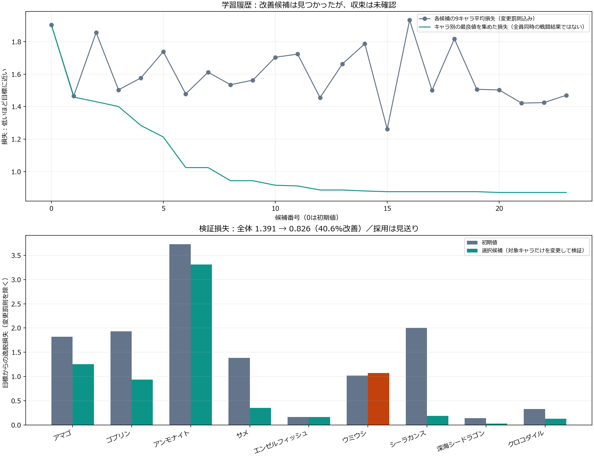

# コストを考慮したキャラ学習の結果分析（2026-10-13）

この分析文書はGPT-6によって書かれています。

対象：`LearningLab/runs/cost-search-role-final-20261012`。保存済みファイルだけを分析し、再学習・ゲームへの適用・採否変更は行っていません。

**改善候補は見つかりましたが、3条件の悪化により不採用です。ゲームの性能値は変更されていません。**

基準1件＋候補23件、各キャラ23回の分布更新。9キャラの25項目を探索しました。
各候補は9キャラ×2編成×2地形×4seed×2陣営＝288試合です。
学習・検証・holdoutは計7,776試合。別枠の編成分析は開始時648試合＋終了後3,096試合です。

| 指標 | 初期値 | 選択候補 | 解釈 |
|---|---:|---:|---|
| 学習損失（変更罰則込み） | 1.904 | 0.871 | 54.3%改善。キャラ別最良値の合成 |
| 検証損失 | 1.391 | 0.826 | 40.6%改善。対象キャラのみ変更 |
| 全員同時変更の検証 | — | 未実施 | 個別検証の採用条件を通過しなかったため |
| holdout損失 | 1.792 | 未測定 | 不採用のため初期値を測定。改善の証拠ではない |

損失は「指定した強弱の目標帯からどれだけ外れたか」です。勝率ではなく、強くなりすぎても増えます。
学習の54.3%改善は最後の候補の成績ではありません。キャラごとの最良候補を集めた値で、全員を同時に変更した対戦は未検証です。

| キャラ | コスト | HP（初期→候補） | 攻撃力（初期→候補） | 防御（初期→候補） | 検証損失（初期→候補） |
|---|---:|---:|---:|---:|---:|
| アマゴ | 1 | 22→29 | 3→3 | 0→35 | 1.822→1.254 |
| ゴブリン | 2 | 20→27 | 6→8 | 0→30 | 1.934→0.936 |
| アンモナイト | 4 | 120→151 | 3→3 | 0→24 | 3.727→3.312 |
| サメ | 8 | 60→86 | 12→14 | 0→15 | 1.381→0.353 |
| エンゼルフィッシュ | 3 | 30→30 | 3→3 | 0→0 | 0.162→0.162 |
| ウミウシ | 3 | 24→33 | 2→3 | 0→5 | 1.018→1.071 |
| シーラカンス | 12 | 154→107 | 30→17 | 0→11 | 2.001→0.189 |
| 深海シードラゴン | 20 | 210→209 | 108→60 | 0→11 | 0.142→0.029 |
| クロコダイル | 12 | 190→162 | 84→89 | 0→0 | 0.331→0.125 |

上表の候補値は不採用です。エンゼルフィッシュは初期値が最良でした。アンモナイトの攻撃力とクロコダイルの防御は固定です。

採用見送りの原因は以下の3条件です。許容する条件別損失の増加は0.05、キャラ平均の増加は0.01です。

| 条件 | 成績（初期→候補） | 損失（初期→候補） | 損失増加 |
|---|---:|---:|---:|
| ammonite-mixed | 0.402→0.396 | 0.426→0.477 | +0.051 |
| shark-mixed | 0.344→0.324 | 0.502→0.706 | +0.204 |
| sea-slug-focused | 0.548→0.759 | 0.000→1.122 | +1.122 |

ウミウシ中心の編成は成績0.548→0.759となり、目標0.45〜0.60を上回りました。混合編成は改善しますが、中心編成の悪化がそれを上回り、キャラ平均損失も1.018→1.071で条件違反です。
サメは中心編成が0.224→0.563と改善する一方、混合編成が0.344→0.324と悪化しました。アンモナイト混合は許容差をわずかに超えています。

現在の基準値での同額編成の強さは以下です。これは終了後の独立した編成分析で、候補適用後の順位ではありません。

| キャラ中心の編成 | コスト | 成績（0〜1） | 勝率 | 試合数 |
|---|---:|---:|---:|---:|
| 深海シードラゴン | 20 | 0.804 | 58.3% | 72 |
| シーラカンス | 12 | 0.788 | 56.9% | 72 |
| クロコダイル | 12 | 0.698 | 54.2% | 72 |
| サメ | 8 | 0.550 | 43.1% | 72 |
| ウミウシ | 3 | 0.440 | 0.0% | 72 |
| エンゼルフィッシュ | 3 | 0.345 | 5.6% | 72 |
| アマゴ | 1 | 0.341 | 0.0% | 72 |
| アンモナイト | 4 | 0.302 | 0.0% | 72 |
| ゴブリン | 2 | 0.232 | 2.8% | 72 |

成績は勝ち1・負け0、時間切れは拠点HPと生存コスト比率から計算します。成績0.440のウミウシ中心編成でも勝率は0%で、生存や時間切れを含んだ値です。
9種類の相手中心編成×2地形×2seed×2陣営で各72試合です。コスト30の編成としての強さであり、個体の1対1性能ではありません。余剰コストを埋めたキャラも寄与します。

混合編成の上積みが大きかった組み合わせ（基準値）：

| 組み合わせ | より良い中心編成に対する平均上積み |
|---|---:|
| ゴブリン＋アンモナイト | +0.318 |
| エンゼルフィッシュ＋ウミウシ | +0.276 |
| ゴブリン＋エンゼルフィッシュ | +0.257 |

ペアは各1体を必須にし、残りを他キャラで埋めた合計30編成です。2体だけの実験ではないため、上積みを純粋な2キャラの因果的シナジーとは断定できません。
試験編成への採用率はアマゴ54.4%、ゴブリン48.5%でした。安いキャラは余りの穴埋めにも入りやすく、これだけで強さや利用価値の高さを確定できません。実プレイヤーの使用率ではありません。

原因として確認できた点と、次に改善する優先順位：

1. 相手の偏りを減らす。抽選対象は対応済み30種類ですが、今回の相手中心種は学習7種類、検証8種類、holdout5種類に限られます。同じ編成・相手を各候補で繰り返しており、試合数の多さだけでは相手の多様性は増えません。まず種別・コスト帯・役割を揃えて網羅し、各組み合わせでseedを分離する設計が必要です。
2. 中心編成と混合編成の目標を分ける。アンモナイトは攻撃力固定のタンクですが、火力役と同じように中心編成の勝敗を目標にしています。中心編成だけでは低評価でも、ゴブリン＋アンモナイトの編成は上積みが大きい結果でした。タンク・支援の貢献は、同額の代替編成との比較や味方生存などでも測るのが妥当です。
3. 以前の1対1・少数編成を補助評価として追加する。同額編成の価値と、個体の優劣・少人数での役割を分けて確認できます。同額評価は維持します。
4. 評価を整えた後で探索を長くする。23更新だけで収束したとは言えません。エンゼルフィッシュの潜在分布標準偏差は一部が上限2.5で、探索は広いままです。中心値自体は未評価で、採用可能な最終性能ではありません。
5. 候補の再検証と全員同時変更の検証を行う。許容差だけを緩めて一括採用するより、悪化した編成の再現性を確認し、必要なら対象キャラを切り分けるのが適切です。今回、候補版のholdoutや全員同時検証は行っていないため、それらの改善は主張できません。

階段状ステージは初期検証で144試合中50試合が時間切れ、直線は27試合でした。移動距離・出撃順・90秒制限も評価に影響します。エナジー回復待ちは評価対象外で、出撃待機列の登録済み個体も死亡していなければ生存コストに含まれる実装です。実ゲーム全体のバランスが確定したとは言えません。

参照：対象runの`manifest.json`、`trial-0000.json`〜`trial-0023.json`、`report.json`、`monitor.json`、`roster-analysis-baseline.json`。採用条件は`learning_lab/validation.py`、評価方法は`learning_lab/cost_balance.py`・`balance.py`・`roster_analysis.py`を確認しました。
