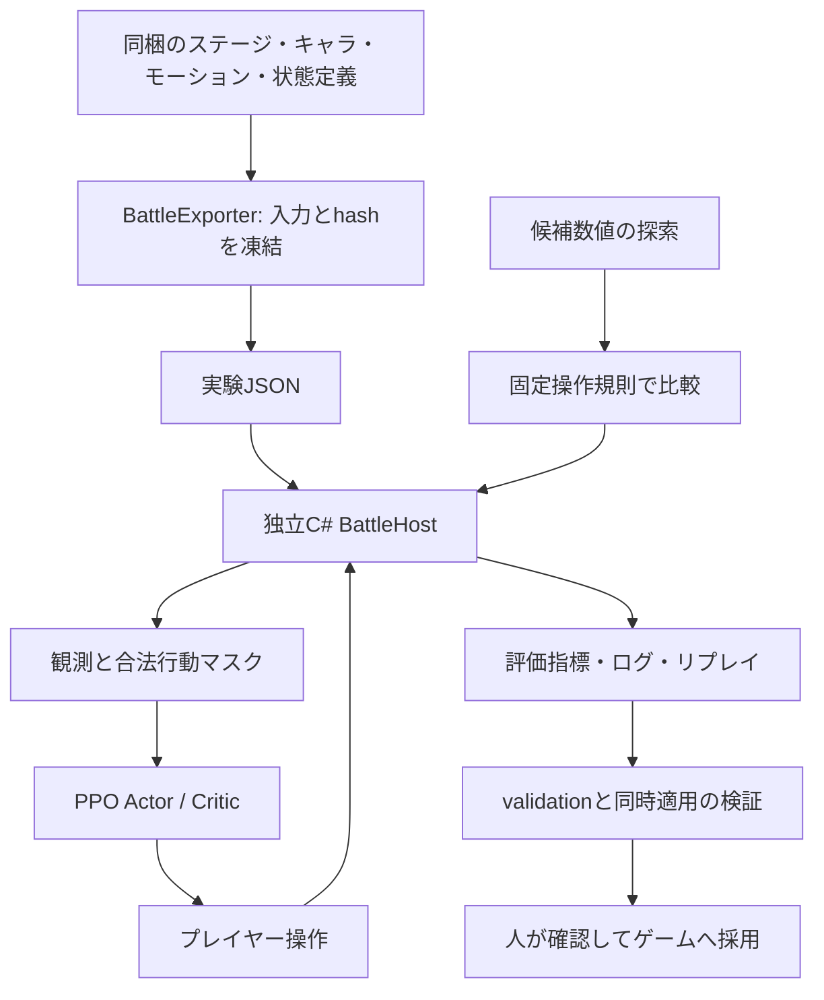
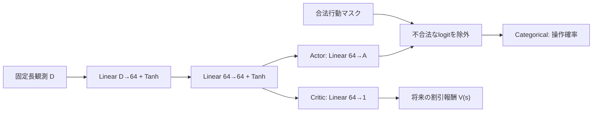

# LearningLab — 操作方策の強化学習とキャラクター数値の評価

このREADMEはGPT-6によって書かれています。

LearningLabは、TowerDefenseの保存済みステージ・キャラクター・モーション・状態定義を使い、Unityを起動せずに戦闘を繰り返す開発用ツールです。Python/PyTorchの学習器と、ゲーム側の数値計算ソースを一部共有する独立C#戦闘ホストを組み合わせています。このリポジトリだけをcloneして実験できます。

実装には、**プレイヤーの操作方策をPPOで学習する系統**と、**操作方策を固定してキャラクターの数値を探索する系統**があります。両方を同時に更新する実験ではありません。現在の戦闘PPOは短い接続確認まで進んでいます。保存済みのキャラ数値探索では、検証で一部の編成が悪化したため、探索候補を採用せず実験用の基準値を維持しています。

**2026-10-06に学習ホストも新操作へ移行しました。目的地・侵攻経路を指定し、固定パーティの枠から1体ずつ即時出撃します。手札選択・commit・ドロー・破棄はありません。** 数値探索は固定AIを使い、引き続きキャラパラメータだけを探索します。PPOを使う場合だけ操作方策の重みを学習します。

本文の現行仕様は2026-10-06のコードに基づきます。第7章の2026-09-23のPPO・528試合・1,920試合は旧操作での履歴です。新操作での動作確認は第7.0節に分け、過去の成績を新操作での成果にはしません。

## 目次

- [1. 何をしているか・何を改善するか](#1-何をしているか何を改善するか)
- [2. プレイヤーと設計者が決めること](#2-プレイヤーと設計者が決めること)
- [3. ステージ構造と1試行の範囲](#3-ステージ構造と1試行の範囲)
- [4. 観測とモデルの構造](#4-観測とモデルの構造)
- [5. PPOの報酬・損失・更新](#5-ppoの報酬損失更新)
- [6. キャラクター数値探索の目的関数](#6-キャラクター数値探索の目的関数)
- [7. 学習・探索の実際の状況](#7-学習探索の実際の状況)
- [8. cloneから実験する手順](#8-cloneから実験する手順)
- [9. 保存物・再現性・ゲームへの採用](#9-保存物再現性ゲームへの採用)
- [10. 適用範囲と今後確認すること](#10-適用範囲と今後確認すること)

## 1. 何をしているか・何を改善するか

| 系統 | 更新するもの | 固定するもの | 目指すこと |
| --- | --- | --- | --- |
| 戦闘PPO（新操作ホスト） | 操作を選ぶActorと、将来報酬を推定するCriticのニューラルネットワーク重み | ステージ、キャラ数値、固定パーティ、戦闘ルール、敵の判断規則 | 味方メイン拠点を守り、敵ボス拠点を占領する操作を獲得する |
| キャラ数値探索 | 指定キャラのHP・攻撃力などの実験用候補値 | 味方の固定操作規則、敵の基準値、役割、技、ステージ条件 | 個性と意図した強弱を保ち、役割別の評価指標を目標範囲へ近づける |
| ナビゲーションデモ | 小さなActor/Criticの重み | 一次元の移動環境 | PPO、評価、再開、リプレイの基盤が動くことを確認する |

PPOがキャラクターのHPや攻撃力を直接増やすことはありません。数値探索もプレイヤー操作AIを学習しません。「強化対象」がどちらかは、実行するCLIによって変わります。

キャラ数値探索の目的は、全員を最大限に強くすることではありません。弱め・標準・強め・編成依存という設計意図を、コスト、役割、地形、編成を揃えた評価で確認します。技・状態・射程・攻撃周期などの既存の個性を保持しながら、必要な数値変更だけを候補にします。



主要実装は [trainer.py](LearningLab/learning_lab/trainer.py)、[policy.py](LearningLab/learning_lab/policy.py)、[ppo.py](LearningLab/learning_lab/ppo.py)、[balance.py](LearningLab/learning_lab/balance.py)、[BattleEnvironment.cs](LearningLab/BattleHost/BattleEnvironment.cs) です。

## 2. プレイヤーと設計者が決めること

### 2.1 現在のゲーム本体の操作

基本操作は、**「目的地・経路を決める → パーティのキャラをクリック → そのキャラ1体が出撃」** です。複数カードを選んでから出撃確定する工程はありません。

- 戦闘に持ち込むパーティは固定12枠です。現実装は取得したキャラを取得順に並べ、重複は1枠にまとめます。パーティを自由に選び直す専用画面はまだありません。
- 表示中のキャラ枠を押すと、選択中の経路の出撃拠点から、そのキャラ1体を出撃させます。枠は消費されず、同じキャラを続けて出せます。生存中の個体がいても、そのキャラの枠は使えます。
- 表の6枠はクリックまたは数字キーで出撃できます。12枠は2ページで、裏ページの枠を押した場合はページをめくります。
- 出撃には、戦闘中でシミュレーションが動いていること、有効な出撃拠点・経路、必要なEnergyがあることを確認します。通常の味方出撃には、旧ホストの手札消費・味方5部隊上限・キャラ別クールタイムの判定はありません。
- Energyは初期5・上限20で、シミュレーション時間1秒ごとに1回復します。1体のコストはデータの `deployCost`、下限1です。

目的地は現在、最大3本の侵攻経路として管理します。経路は「出撃拠点 → 経由地点0〜2個 → 侵攻地点」です。開始時には最寄りの敵拠点の手前へ向かう経路Aを自動配置します。必要なら別の経路・目的地・出撃拠点を選び、その後はキャラのクリックだけで追加出撃できます。

各キャラは出撃時に選択されていた経路に結び付きます。別経路へ選択を切り替えても、既出撃キャラの経路は変わりません。その経路自体を変更したときは、結び付くキャラが現在地から新しい経路へ合流します。内部では1体ごとに `RuntimeSquad` を作りますが、ユーザーが複数キャラの部隊を編成・確定する操作ではありません。

ゲーム本体の確認箇所は [PartyFormation](https://github.com/skobayashi-glb/TowerDefense/blob/main/Assets/Scripts/Battle/Squads/PartyFormation.cs)、[PartySlotsUIのHandlePick/Sortie](https://github.com/skobayashi-glb/TowerDefense/blob/main/Assets/Scripts/GameUI/SortieHand/PartySlotsUI.cs)、[SortieCommandControllerのTrySortie](https://github.com/skobayashi-glb/TowerDefense/blob/main/Assets/Scripts/Battle/Squads/SortieCommandController.cs)、[InvasionRouteBoard](https://github.com/skobayashi-glb/TowerDefense/blob/main/Assets/Scripts/Battle/Squads/InvasionRouteBoard.cs) です。`GameTransition` がこのUIとコントローラを実際にAttachすることも確認しています。

### 2.2 LearningLabの現在の操作API

ユニットの移動・旋回・索敵・攻撃はホストが進めます。方策は毎tick個体を直接動かすのではなく、出撃するキャラと、必要なら出撃拠点・侵攻経路を決めます。

| 行動 | 操作の意味 |
| --- | --- |
| `deploy:i` | 固定パーティの枠iのキャラを1体、選択中の経路へ即時出撃。枠は消費しない |
| `route:i` | 経路スロットiを選択。空なら作成し、次のセル指定で経由地点を消して引き直す |
| `cell:x:y` | 選択直後なら侵攻地点を置く。以降は前の侵攻地点を経由地点へ移し、次の侵攻地点を置く |
| `base:i` | 選択経路の出撃拠点を変更。これから出すキャラだけに適用 |
| `route-remove:i` | 経路を削除。使用個体を残った選択経路へ付替え、なければ最後の経路・目的地を保持 |
| `cancel-route-edit` | 次のセル指定での引き直しを取り消す。経路は消さない |
| `wait` | 操作せず戦闘を進める |

例えば `route:0 → cell:4:6 → cell:11:4 → deploy:0 → deploy:0` で、経由地点(4,6)・侵攻地点(11,4)の経路へ、枠0のキャラを2体続けて出せます。開始時の経路Aを使うなら `deploy:0` だけで出撃します。`commit` はありません。

全操作の後に既定0.5秒（最大30tick）を進めます。これが学習の判断間隔です。経路編集でも時間は進み、無時間操作の連続によって戦闘を止める仕組みは廃止しました。ゲームのクリックが常に0.5秒かかるという意味ではなく、リアルタイム操作を一定間隔で標本化するホスト側の近似です。

合法行動マスクは、空パーティ枠、Energy不足、通行不可セル、経路の不通、存在しない拠点や経路への操作を除外します。目的地と出撃元は待機・出撃後も保持します。出撃口が埋まっている個体は、支払い・登録済みのまま空くまで待ちます。

### 2.3 ゲーム本体との対応と実装の限界

| 項目 | ゲーム本体とLearningLabの対応 |
| --- | --- |
| パーティ | 既定12枠、同キャラ1枠。ホストでは実験JSONの`roster`で順序を指定し、重複を拒否 |
| 出撃 | 1クリックに対応する`deploy:i`で1体。生存中でも同じ枠から繰り返し出撃可能 |
| 味方部隊 | 旧5部隊制限を廃止。内部では1体ごとに部隊IDを持つ |
| Energy | 既定の初期5・最大20・1秒ごとに1回復。campaignの初期値は比較条件として上書き |
| 侵攻経路 | 既定3本、経由地点2個まで。経路選択のみでは既出撃個体を変更せず、内容編集時に紐付く個体だけ合流 |
| ドロー・破棄 | なし。死亡時も固定パーティは変わらない |
| Enemy部隊 | 敵だけ`enemy_squad_limit`の既定5を使用 |

ホストの経路は四近傍の歩行経路を経由地点ごとに連結します。経路編集時には現在地から到達可能な経路セルを選び、到達距離＋残経路長×0.5の最小値で合流位置を決めます。戦闘の寄り道後は保持した進捗以降へ戻ります。出撃拠点だけの変更では、既出撃個体の道のりを置き換えません。

観測の`units=256`はホストの固定長ベクトル容量で、ゲーム上の出撃制限ではありません。超過時は出撃を無効にして成績を続けず、実験をエラーにします。より大きいenvelopeで再出力してください。Unity本体との移動・接触・索敵・戦闘結果の完全一致は未検証です。

保存済みの528試合・1,920試合は旧手札8枠・3秒回復での結果です。新操作用の単体caseは対象キャラ1枠、混成caseは対象＋補助キャラの重複なしパーティへ変更しました。旧結果や旧checkpointは現行schemaに流用せず、新しいconfig・runで評価し直します。

### 2.4 実験を設計する人が決めること

| 設計項目 | 保存場所・設定 | 意味 |
| --- | --- | --- |
| ステージと用途 | `battle_setup.json` / `defense_training_stages.json` の `scenarios` | 地形・拠点とtrain/validation/holdoutの割り当て |
| 所持カード | scenarioの `roster` | 同じキャラの重複は別のカードとして扱う |
| 敵の条件 | `enemy_pool`、敵拠点、敵Energy・出撃間隔 | 比較相手と敵の出撃条件を固定する |
| 勝利対象 | `boss_base_index` | 省略時は唯一のMain型敵拠点を使う |
| 時間・資源 | `rules` | 試合時間、Energy、パーティ・経路・敵部隊の設定など |
| PPOの設定 | `training.ppo` または実験JSONの `ppo` | ネットワーク幅、学習率、rollout長、損失係数など |
| キャラの初期案・役割 | `character_balance_plan.json` / `defense_training_plan.json` | 個性、弱点、初期数値、探索するキャラ、候補範囲 |
| 意図する強弱 | `strength_assignments.json` | `weak / standard / strong / conditional` を全42体について指定 |
| 評価目標 | planの `role_targets` と `strength_bands` | 役割・強弱に応じた指標の目標帯と重み |
| 試行数 | `candidate_budget`、分割別seed、ステージ数 | どの条件で何回比較するか |

強弱のラベルは設計者が決めます。探索器はその割り当てを変更しません。高コストで弱めという指定も可能です。ここでいう強弱は主にコスト当たりの効率を意図し、絶対ダメージの大小だけを意味しません。

## 3. ステージ構造と1試行の範囲

### 3.1 保存済みステージ

ステージは [Assets/Editor/LearningDebugStages](Assets/Editor/LearningDebugStages) のUnity `StageDefinition` を読み取ります。Editor専用データであり、ゲームの製品用ステージカタログへの登録は行いません。

| ステージ | 大きさ | 地形と拠点 | 用途 |
| --- | --- | --- | --- |
| `RL_OpenField` | 15×9 | 外周を壁で囲んだ開けた平地。味方(2,4)、敵ボス(12,4) | train |
| `RL_ChokePoint` | 15×9 | 中央の壁で進路を絞る。中央付近に通路を残す。拠点位置はOpenFieldと同じ | validation |
| `RL_Detour` | 15×9 | 拠点間の直進を中央壁で塞ぎ、下側の通路へ迂回させる | 初回実験のholdout |
| `RL_DefenseHoldout` | 15×11 | 中央壁に上下2本の通路があり、追加の障害物も置く。味方(2,5)、敵ボス(12,5) | 防御力探索のholdout |

座標は左下を原点とする `(x,y)` です。次の図は保存アセットの地形と拠点原点をそのまま示します。上が大きいy、`.`は通路、`#`は壁、`A`は味方メイン、`B`は敵ボスです。拠点の占有範囲・出撃口は図では省略しています。

```text
OpenField          ChokePoint         Detour
###############    ###############    ###############
#.............#    #......#......#    #......#......#
#.............#    #......#......#    #......#......#
#.............#    #.............#    #......#......#
#.A.........B.#    #.A.........B.#    #.A....#....B.#
#.............#    #......#......#    #.............#
#.............#    #......#......#    #.............#
#.............#    #......#......#    #......#......#
###############    ###############    ###############

DefenseHoldout
###############
#......#......#
#...#..#......#
#.........#...#
#......#......#
#.A....#....B.#
#......#......#
#.........#...#
#...#..#......#
#......#......#
###############
```

地形の保存値は通路0、壁候補1、確定壁2です。壁候補がある場合はステージのgeneration seedと設定確率で通行可否を決めます。今回の4マップには通路と確定壁だけがあります。拠点は原点のほかに占有セルと出撃口を持ち、出撃口はマップ内・通行可能である必要があります。

### 3.2 1試合・1エピソードの開始と終了

**1エピソードは、1つのscenarioとseedで `reset` した直後から、勝利・敗北・時間切れのいずれかまでです。** 1回の出撃や、1体の死亡を1エピソードにはしません。拠点、Energy、固定パーティ、ユニット、経路と個体の紐付け、敵出撃の乱数、判断履歴を初期化して開始します。

| 終了条件 | ホストのoutcome | PPOでの扱い |
| --- | --- | --- |
| 味方が敵ボス拠点を占領 | `victory` | `terminated=true`。最後の状態から価値をbootstrapしない |
| 味方メイン拠点HPが0以下 | `defeat` | `terminated=true`。最後の状態から価値をbootstrapしない |
| 試合時間上限まで未決着 | `timeout` | `truncated=true`。最後の観測から価値をbootstrapする |

同じtickで複数条件を満たす場合、実装の判定順は勝利、敗北、時間切れです。一般のStageDefinitionが持つ複合勝利条件をすべて取り込む形式ではありません。

戦闘の固定tickは既定1/60秒、全行動の判断間隔は既定0.5秒です。各行動で最大30tick進め、途中で終了条件を満たせば止めます。今回の設定の上限90秒は最大180判断です。PPOの学習打切りや評価の監視上限は、これとは別に指定します。
PPOはエピソード終了時に次の学習scenarioを重みに従って抽選し、新しいseedでresetします。途中のrollout更新やチェックポイント保存では、未終了の試合をresetせず続けます。学習の `--steps` は全エピソードを通じた**累計判断数**で、試合数・tick数・秒数ではありません。

評価には別途 `max_decisions=5000` の監視上限があります。これを超えた場合は実験エラーです。通常の `timeout` と同じ成績として処理しません。

### 3.3 数値探索の「試行」と「候補」

数値探索での1試合は、**候補数値 × 評価case × ステージ × seed** の組み合わせをresetから終了まで実行したものです。「候補1件」は8体の候補数値を含む組み合わせ全体であり、各キャラに24件ずつという意味ではありません。

現在のcaseは8体それぞれに単体・混成の2種類、計16caseです。

- 単体: 評価対象キャラだけの固定パーティ。枠から何度でも出撃できます。
- 混成: 評価対象、shark、ammoniteの固定パーティ。同キャラは1枠にまとめ、2〜3枠で評価します。
- 個別評価: `freeze_others=true` で評価対象だけ候補値にし、ほかの味方は実験用基準値を使う。
- 同時適用評価: 全キャラに候補値を同時に適用し、混成での相互作用を確認する。

保存済みの旧防御力探索では1分割あたり1ステージ×4seed×16case=64試合です。24候補のtrain探索は24×64=1,536試合になります。後述のvalidationなどを加えた実際の総数は1,920試合です。

### 3.4 train / validation / holdout

trainは候補探索または方策更新、validationは比較と採否判断、holdoutは採否を決めた後の最終確認に使います。同じステージfamilyを分割間で混ぜる設定は拒否します。数値探索のseedも分割間の重複を拒否します。

防御力探索ではtrainにOpenField・10101〜10104、validationにChokePoint・11101〜11104、holdoutにDefenseHoldout・12101〜12104を使いました。初回の個性評価ではDetourと各3seedを使っています。ステージ設定内のPPO評価用seedとは別に、数値探索はplanから生成した分割別seedを使います。

## 4. 観測とモデルの構造

以下は新しい固定パーティ・侵攻経路ホスト（`battle-v3-party-routes`）の仕様です。

### 4.1 方策に渡す観測

観測は固定長float32ベクトルとbooleanの合法行動マスクです。構造は実験ごとの `envelope` に固定します。範囲外のマップ・ユニット・拠点数などを暗黙に切り捨てる設定にはしません。

| ブロック | 含まれる情報 |
| --- | --- |
| 全体15要素 | 経過時間、味方Energyと回復進捗、味方個体部隊数、経路引き直し待ち、パーティ枠数、目的地、選択経路、経路数、敵出撃予告の有無・残時間・人数・出撃元位置 |
| 固定パーティ（1枠8要素） | 存在、キャラID、コスト、HP、攻撃力、速度、防御値、同キャラの生存・出撃待ち個体数 |
| 拠点 | 存在、陣営、HP比率、位置、味方メイン・敵ボスの種別、選択中の出撃元か |
| ユニット | 存在、陣営、キャラID、HP比率、位置、向き、出現済みか、攻撃中か、状態数、目的地、攻撃回復・準備の残時間、選択経路との関係、隊列順、経路ID、経路進捗、各状態の残時間。防御値は追加ブロック |
| マップ | 各セルの通行可否と拠点占有セルか |
| 侵攻経路 | 存在、選択中か、出撃拠点ID、侵攻地点、経由地点数、使用個体数、経路が有効か、各経由地点 |

空スロットは0で埋めます。位置・時間・HPなどは実装で定めた上限・基準値で正規化します。防御チャンネルは `defense / (100 + defense)` です。キャラIDは定義順のスカラー表現で、学習済みEmbeddingではありません。

ユニットの同時点の位置などは盤面全体を観測します。一方、敵の内部乱数状態・今後の抽選結果は渡しません。敵Energy残量もこの観測の全体ブロックには直接含まれません。保存・リプレイ用の内部状態を、方策の入力に混ぜません。

幅W、高さH、パーティ容量P、拠点容量B、ユニット容量U、経路容量R、経由地点容量M、基礎状態数Kとして次の次元です。

```text
D = 15 + 8P + 8B + (19 + K)U + 2WH + R(8 + 2M) + U
A = 2 + P + 2R + B + WH
```

現在K=11、P=12、B=8、U=256、R=3、M=2。15×9では **D=8,417・A=163**、15×11では **D=8,477・A=193** です。防御力探索は小さいtrain/validationマップも15×11へパディングします。旧防御ホストの2,294/2,354要素と160/190行動とは互換性がありません。

### 4.2 Actor-Critic

[MaskedActorCritic](LearningLab/learning_lab/policy.py) は、共通の2層MLPと2つの出力ヘッドです。既定の隠れ層幅は64です。



学習中はCategoricalから行動をサンプリングし、方策評価では最大logitの合法行動を選びます。不合法なlogitはfloatの最小値へ置き換えます。毎観測に少なくとも1つの合法行動が必要です。

Linearの重みは直交初期化、biasは0です。隠れ層のgainは√2、Actorは0.01、Criticは1です。現実装はCPU、単一環境、履歴を持たないフィードフォワードです。CNN、Transformer、LSTM、複数環境の並列rolloutは使っていません。

数値探索側にはニューラルモデルがありません。`ParameterSpace` が離散候補を抽選し、`ScriptedSortiePolicy` が固定操作を選び、`BalanceEvaluator` が成績を集計します。

## 5. PPOの報酬・損失・更新

### 5.1 戦闘報酬

報酬は [BattleEnvironment.Step](LearningLab/BattleHost/BattleEnvironment.cs) と [Rules](LearningLab/BattleHost/Data.cs) で定義します。現在の設定が上書きしていない既定値では次です。

| 状態 | 報酬 |
| --- | --- |
| 勝利 | `1 + 0.1 × 味方メイン拠点の残HP比率` |
| 敗北 | `-1` |
| 継続中の操作・時間切れ | `0` |

勝利と、勝利時に拠点HPを残すことを報酬にしています。途中の与ダメージ・敵撃破・移動・選択操作に個別の正報酬は付けていません。数値探索で記録するダメージ効率などを、そのままPPOの報酬にはしていません。

現在のホストは全行動で `discount_steps=1` を返します。旧ホストのカード選択では0でしたが、その無時間操作は廃止しました。GAEの汎用実装は経過時間指定に対応したままです。

### 5.2 GAEと終端の扱い

[generalized_advantages](LearningLab/learning_lab/ppo.py) は、価値推定と報酬からAdvantageを作ります。`d_t` をdiscount_steps、`T_t` をterminated、`C_t` を「terminatedでもtruncatedでもない」とすると、実装は次の形です。

```text
δ_t = r_t + γ^d_t × (1 - T_t) × V(s_{t+1}) - V(s_t)
A_t = δ_t + γ^d_t × λ^d_t × C_t × A_{t+1}
R_t = A_t + V(s_t)
```

勝利・敗北ではbootstrapを切ります。時間切れでは最後の観測の価値を使いますが、GAEの連鎖はそのエピソードで止めます。次にresetした試合の報酬を、前の試合へつなぎません。Advantageはrollout内で平均0・標準偏差1に正規化してから方策損失に使います。

### 5.3 最小化する損失

同じ行動について、新方策と収集時の旧方策の確率比を `ρ_t = exp(log π_new - log π_old)` とします。

```text
L_policy = -mean(min(ρ_t A_t, clip(ρ_t, 1-ε, 1+ε) A_t))
L_value  = 0.5 × mean((V(s_t) - R_t)^2)
H        = mean(Categoricalのentropy)
L_total  = L_policy + value_coefficient × L_value
                    - entropy_coefficient × H
```

`ε` はここでは `clip_range` です。optimizerの `epsilon` とは別の値です。PPOのclipで方策の変更を抑え、価値損失で将来報酬の予測を合わせ、entropy項で探索を保ちます。価値損失は上の二乗誤差で、value clippingは実装していません。

既定値では `L_total = L_policy + 0.5 L_value - 0.01 H` です。`L_value` 自体に0.5が含まれるので、二乗誤差に対する総係数は0.25です。`metrics.jsonl` は方策損失・価値損失・entropyを別々に記録します。

### 5.4 学習設定と更新単位

現在の `demo.json` と戦闘setupのPPO設定は次です。

| 設定 | 値 | 意味 |
| --- | ---: | --- |
| `hidden_size` | 64 | 共通MLP各隠れ層の幅 |
| `rollout_steps` | 256 | 1更新前に集める判断数。試合途中を含める |
| `epochs` | 4 | 同じrolloutを4回使って更新 |
| `minibatch_size` | 64 | 更新時の小分けサイズ |
| `learning_rate` | 0.0003 | Adamの学習率 |
| `gamma` | 0.99 | 時間を進める判断ごとの割引率 |
| `gae_lambda` | 0.95 | GAEの係数 |
| `clip_range` | 0.2 | 方策確率比のclip幅 |
| `value_coefficient` | 0.5 | 価値損失の係数 |
| `entropy_coefficient` | 0.01 | entropyの係数 |
| `max_grad_norm` | 0.5 | 勾配ノルムの上限 |
| `epsilon` | 1e-8 | AdamとAdvantage正規化で使う微小値 |
| `torch_threads` | 1 | PyTorchのCPUスレッド数 |

256判断ごとにrolloutを収集し、シャッフルした64件のminibatchを4epoch更新します。最後のrolloutは指定累計判断数に合わせて短くなる場合があります。更新後にモデル・optimizer・乱数・環境状態・累計進捗を保存します。更新をまたいで試合が続くことがあります。

## 6. キャラクター数値探索の目的関数

### 6.1 今回の対象と固定値

42体の初期設計を用意し、保存済み監査では30体がホスト対応、12体は未対応能力があるため除外しています。そのうち次の8体を実験対象にしました。下表は実験用初期案で、現在のUnityアセット値と同じとは限りません。

| キャラ | 役割 | 意図する強弱 | コスト | HP | 攻撃力 | 速度 | 防御 |
| --- | --- | --- | ---: | ---: | ---: | ---: | ---: |
| amago | 火力 | weak | 1 | 22 | 3 | 1.8 | 0 |
| goblin | 火力 | strong | 1 | 20 | 6 | 1.15 | 0 |
| ammonite | 壁 | strong | 2 | 120 | 3 | 0.6 | 0 |
| shark | 火力 | standard | 3 | 60 | 12 | 1.7 | 0 |
| angelfish | 状態付与 | conditional | 3 | 30 | 3 | 1.05 | 0 |
| sea-slug | 状態付与 | weak | 3 | 24 | 2 | 0.42 | 0 |
| coelacanth | 火力 | weak | 6 | 154 | 30 | 0.62 | 0 |
| abyssal-sea-dragon | 火力 | strong | 9 | 210 | 108 | 0.58 | 0 |

一般の探索は `hp / power / speed / cost / defense` に対応しますが、今回のplanでは速度とコストを固定し、HP・攻撃力・明示した防御候補を探索します。壁役の攻撃力も固定します。HPの候補倍率は0.9/1/1.1、火力役の攻撃力は0.85/1/1.15、状態役は0.9/1/1.1です。整数に丸め、基準値を含めます。防御候補はammoniteが0/25/50、ほかの7体が0/10/20です。

技、状態付与、射程、攻撃周期、役割、敵の元ステータスは変更しません。通常攻撃の防御軽減と、状態・状態反応ダメージの防御無視は [防御仕様](Docs/defense_damage_spec.md) に従います。

敵poolはshark、amago、ammonite、blue-surgeonfishです。敵定義は元アセットから取った別スナップショットです。味方の実験用初期案・候補を敵へ反映しません。今回のcampaignでは味方初期Energy10、敵8、敵判断間隔6秒、試合時間90秒を使用します。

### 6.2 比較用の固定操作

`fixed-party-round-robin-to-default-route-v3-target-first` は、既定の経路Aを使い、固定パーティの枠順を巡回して1体ずつ即時出撃します。次の枠のEnergyが足りない間は待ち、安いキャラだけが高コストキャラの出撃機会を奪わないようにします。戦術的な経路・目的地変更は行いません。この規則自体は学習しません。

`target_first=true` では評価対象の初回出撃を優先し、必要なEnergyを貯めます。出撃後は次の枠から巡回します。評価対象が一度も出撃しなければ、成績を付けず実験エラーにします。旧カードAIと同じ出撃頻度になるわけではなく、操作条件の変更として成績を評価し直します。

敵は予算内でpoolから抽選し、出撃予告後に出ます。候補間で判断規則とseedを揃えますが、性能変更で戦況が変わるため、実際の判断列が完全に同じになるとは限りません。

### 6.3 指標と目標帯

| 指標 | 計算 | 主に見ること |
| --- | --- | --- |
| `damage_per_energy` | 評価対象の有効与ダメージ ÷（出撃数×当該候補のコスト） | コスト当たり火力 |
| `survival_fraction` | （出撃数−死亡数）÷出撃数 | 終了時に死亡していない割合 |
| `main_hp_ratio` | 終了時の味方メイン拠点HP÷初期HP | 防衛への補助指標 |
| `win_rate` | 勝利の試合数÷試合数。時間切れは勝利に含めない | その編成でのクリア能力 |

出撃数には出撃口で待機中の個体も含みます。有効与ダメージは、相手の残HPを超える過剰ダメージを含めません。単体・混成の成績は同じ指標でも別caseとして計算します。

現在の8体用planの最適化目標はダメージ効率・生存率・拠点HPの3指標です。勝率も記録しますが、現在のplanでは勝率に直接の損失項を設定していません。利用可能な指標と、実際に今回使った指標を区別してください。

基本ダメージ効率帯はweak=2〜4、standard=4〜7、strong=6〜12、conditional=3〜8です。これに役割別倍率を掛けます。火力役は倍率1・ダメージ重み3、壁役は倍率0.3・生存重み2・拠点HP重み3、状態役は倍率0.45・拠点HP重み2です。生存率・拠点HPの目標帯にも役割・強弱の設定を適用します。生成済みの `targets.json` が実験で使う具体的な目標値です。

### 6.4 探索損失

指標ごとの平均値をm、目標下限をl、上限をu、評価尺度をs、指標重みをwとします。各case内でステージweightとseedの成績を平均した後、次を計算します。

```text
指標の帯外距離 = max(l - m, m - u, 0)
case損失 = Σ w × (帯外距離 / s)^2 / Σ w
評価損失 = Σ case_weight × case損失 / Σ case_weight

探索score = train評価損失 + change_weight × 変更量罰則
変更量罰則 = mean(((候補値 - 基準値) / 正規化尺度)^2)
```

通常の変更量の尺度は当該パラメータの基準値、防御では `max(100, 基準防御)` です。防御の基準が0でもゼロ除算しません。今回の `change_weight` は0.08です。目標帯内の指標損失は0なので、無制限に数値を上げる必要はありません。

PPO損失はモデル重みを勾配で更新する損失です。一方、この評価損失は候補数値を比較するスコアで、ニューラルネットワークの逆伝播は行いません。離散候補の重複なしランダム探索で、基準値を最初に評価します。大域最適な調整値の証明ではありません。

### 6.5 採用条件

1. trainだけで、基準値を含む候補から探索score最小の候補を選ぶ。同点は先に評価した候補を使う。
2. validationで基準値と候補を比較する。全体損失とすべての個別case損失が非悪化であることを要求する。
3. 個別評価でほかの味方を固定した場合、全候補を同時適用してvalidationを再確認する。全体または1caseでも悪化すれば採用しない。
4. 採否を決めた推奨値でholdoutを1回評価する。不採用なら基準値を評価する。holdoutで別候補を選び直さない。

平均の改善で特定の編成の悪化を隠さない条件です。条件を通らない場合の基準値維持は、探索プログラムのエラーではありません。

## 7. 学習・探索の実際の状況

### 7.0 新操作への移行確認（2026-10-06）

[party_controls_migration_20261006.json](LearningLab/results/party_controls_migration_20261006.json) に新操作の小規模な確認結果と入力ソースhashを保存しています。

- C#ホストをビルドし、54テストをskipなしで確認。繰り返し即時出撃、味方6部隊以上、経路の選択と編集、経由地点の通過、削除・付替え、出撃元変更、1秒回復、状態復元、旧schema拒否を含みます。
- 実キャラのamago・abyssal-sea-dragonについて、単体・混成の4case、2候補、分割別各1seedで数値探索を実行。train8試合、個別・同時適用validation12試合、holdout4試合、計24試合です。OpenField / ChokePoint / Detourを使いました。
- この小規模候補はvalidation条件を通りましたが、ゲームへの適用はしていません。全8体・多数seedでの本評価ではなく、探索フローが新操作で動くことの確認です。
- 新schemaでPPO64判断・2更新を実行し、ネットワーク重みの更新と、保存から同じ判断列・戦闘状態へ再開できることを確認。完了した1試合は敗北で、強いAIの獲得を示す結果ではありません。
- 528試合・1,920試合の既存結果と旧checkpointは変更せず保存。今後の本規模の評価には、新しい実験JSONとrunを使います。


### 7.1 PPOの保存ログ

元環境のローカル `runs` に残っていたmanifest・metrics・評価JSONから、[ppo_smoke_checks.json](LearningLab/results/ppo_smoke_checks.json) に小さい要約と元ログのSHA-256を保存しています。下表は過去のログであり、今回README作成時に新しい本学習を実行した結果ではありません。

| run | 累計判断 | 更新数 | 完了エピソード | 保存済みvalidation |
| --- | ---: | ---: | ---: | --- |
| `verification` | 8,448 | 33 | 1,431 | ナビゲーションデモ8試行中8回到達、平均報酬1.0 |
| `battle-integration` | 512 | 2 | 1 | 戦闘2試合とも敗北、平均報酬−1.0 |
| `battle-v2` | 512 | 2 | 1 | 戦闘2試合とも敗北、平均報酬−1.0 |

最後の更新に記録された損失は次です。rollout・minibatchに対する平均で、試合の勝率とは別です。

| run | policy_loss | value_loss | entropy |
| --- | ---: | ---: | ---: |
| `verification` | −0.00292454 | 0.00087741 | 0.55491861 |
| `battle-integration` | −0.00626682 | 0.13892902 | 4.43708915 |
| `battle-v2` | −0.00611865 | 0.13397564 | 4.43476120 |

デモのsuccessは移動先への到達で、ゲームの勝利ではありません。戦闘の512判断は接続確認の規模であり、強い操作AIの獲得や収束は確認できていません。`battle-v2`というrun名でも、保存manifestの観測schemaは旧 `battle-v1`、2,222要素です。その後の防御ホストは`battle-v2-defense`・通常2,294要素、現在は固定パーティの`battle-v3-party-routes`・通常8,417要素です。

旧戦闘checkpointを現在の実装へそのまま再開できるという意味ではありません。再開にはconfig hash、schema、Python/NumPy/PyTorch・ツール版が一致する必要があります。現在のホストでは実験JSONを再出力し、新しいrunで学習・評価する必要があります。元の大きなログとcheckpointはGitに保存せず、要約を保存しています。

### 7.2 個性・役割を使った初回数値探索 — 2026-09-23

[identity-first-run.json](LearningLab/results/identity-first-run.json) と [初回実験記録](Docs/rl_character_balance_first_run.md) に結果があります。

- 8体×単体・混成の16case、基準値を含む8候補、各分割3seed。
- train384試合、validation96試合、holdout48試合、計528試合。
- train探索score: 基準10.18352 → 選択候補10.10729。
- validation平均損失: 基準13.98480 → 選択候補13.91508。
- ゴブリン単体とエンゼルフィッシュ混成のcaseが悪化し、不採用。
- 基準値を維持し、holdoutを評価。ゲームアセットへの反映なし。

平均改善だけでは、役割・強弱の設計が達成されたとは判断していません。

### 7.3 防御力を含む数値探索 — 2026-09-23

[defense_training_20260923.json](LearningLab/results/defense_training_20260923.json) と [防御力探索の実験記録](Docs/rl_defense_training_run.md) が最終判定です。これは固定操作による数値探索であり、PPOの操作学習ではありません。

| 比較 | 実験用基準値 | trainで選んだ候補 |
| --- | ---: | ---: |
| train探索score（変更量罰則込み） | 8.49575 | 8.00715 |
| 個別validation損失 | 11.14322 | 10.26407 |
| 全候補同時適用validation損失 | 11.14322 | 10.09242 |

個別validationでは16caseすべてが非悪化でしたが、同時適用で `angelfish-mixed` の損失が **3.65477 → 4.06239** に悪化しました。全体平均は改善していても、case非悪化の条件を通らないため、最終推奨は基準値維持です。`passed_validation_gate=false`、`applied_to_game=false` です。最終推奨の防御は全8体で0です。

| 処理 | 試合数 |
| --- | ---: |
| 24候補のtrain探索 | 1,536 |
| 基準・候補の個別validation | 128 |
| 旧フローが先に計算した候補holdout。採否には使っていない | 64 |
| 基準・候補の同時適用validation | 128 |
| 基準値維持後の最終holdout | 64 |
| 合計 | 1,920 |

最終holdoutの基準値損失は3.54647です。別ステージなので、train/validationの値と単純に比較して学習の改善率を計算しません。旧フローでは候補holdoutを先に実行しましたが、採否に使っていません。現在の `BalanceSearch.run` は同時適用validationで採否を決めた後にholdoutを評価します。

各4seedの小規模な結果です。強弱順位、目標帯の適切さ、統計的な確証、Unity本体での適正バランスは未確認です。閲覧済みのholdoutを次の設計変更の最終確認に繰り返し使わず、新しい未閲覧のfamily・seedを準備します。

## 8. cloneから実験する手順

### 8.1 準備

Python 3.10以降と.NET 10 SDKが必要です。CPUで動き、CUDA・Unity・Node.js・ほかのツールのcloneは不要です。以下はこのリポジトリのルートで実行します。固定バージョンのPython依存はルートの `requirements.txt` にあります。

```powershell
python -m venv .venv
.\.venv\Scripts\Activate.ps1
python -m pip install -r requirements.txt
python scripts/prepare.py
python scripts/check.py
cd LearningLab
```

`prepare.py` はBattleHostをビルドします。以後の例は `LearningLab` ディレクトリで実行します。既存runを上書きしないので、出力名は新しいものを使ってください。

### 8.2 戦闘PPO

```powershell
python -m learning_lab.export_battle --setup configs/battle_setup.json --output runs/battle-input.json
python -m learning_lab train --config runs/battle-input.json --run runs/battle-policy --steps 8192
python -m learning_lab evaluate --config runs/battle-input.json --checkpoint runs/battle-policy/checkpoint.pt --split validation --output runs/battle-policy/validation.json
python -m learning_lab evaluate --config runs/battle-input.json --baseline random --split validation --output runs/battle-policy/random-validation.json
python -m learning_lab replay --config runs/battle-input.json --report runs/battle-policy/validation.json
```

8,192判断は実行例であり、十分な学習量という基準ではありません。validationで固定条件の成績とbaselineを確認し、設定とcheckpoint選択を決めた後だけ、`--split holdout` を明示して最終確認します。デモを試す場合は `configs/demo.json` を使います。

再開では同じrunへ、追加数ではなく到達したい累計判断数を指定します。

```powershell
python -m learning_lab train --config runs/battle-input.json --run runs/battle-policy --steps 16384 --resume runs/battle-policy/checkpoint.pt
```

### 8.3 防御力を含む数値探索

```powershell
python -m learning_lab.campaign --plan configs/defense_training_plan.json --template configs/defense_training_stages.json --strengths configs/strength_assignments.json --output runs/defense-next-input
python -m learning_lab.balance --config runs/defense-next-input/experiment.json --settings runs/defense-next-input/targets.json --run runs/defense-next-search
```

campaignは初期設計・強弱割り当てから凍結実験JSON、評価目標、キャラ監査を生成します。数値探索は現在のフローでtrain、個別validation、必要な同時適用validation、最終holdoutを実行します。過去の途中フローも含めて1,920試合を完全に再現するコマンドではありません。

最初の8候補の条件を使う場合は `character_balance_plan.json` と `battle_setup.json` を指定します。単純な探索例は [BALANCE.md](LearningLab/BALANCE.md) も参照してください。数値探索CLIには中断からの再開機能はなく、新しいrunで実行します。

### 8.4 検証

```powershell
python -m unittest discover -s tests -v
python check_release_boundary.py
```

BattleHostをビルドしてから実行します。未ビルドなら戦闘テストがskipされるため、skipなしの結果を確認してください。独立したリポジトリ配置で54テストの成功を確認しています。境界検査は、このrepoに含まれるAssetsに対する静的検査です。製品ゲーム全体の境界確認はTowerDefense側でも行う必要があります。

## 9. 保存物・再現性・ゲームへの採用

| 出力 | 内容 |
| --- | --- |
| PPO `manifest.json` | config、hash、観測schema、実行環境・ツール版 |
| PPO `checkpoint.pt` | モデル・optimizer、乱数、環境状態、判断数・更新数・途中エピソード進捗 |
| PPO `metrics.jsonl` | 更新ごとの損失・entropy・累計進捗と、完了したエピソードの成績 |
| PPO評価JSON | 成績の平均、終了理由、シナリオ別の試合、行動・観測・状態hashを含むリプレイ |
| campaign `experiment.json` / `targets.json` | 凍結した戦闘入力と、具体的な候補・評価目標 |
| campaign `character-audit.json` / `plan.json` / `strength_assignments.json` | 対応能力の監査、設計案、ユーザー指定の強弱スナップショット |
| 探索 `trial-*.json` | 候補ごとのtrain成績・探索score |
| 探索 `report.json` / `recommended-config.json` | 検証ゲートの結果、推奨候補を適用した実験JSON |
| `LearningLab/results/*.json` | Gitに保存する小さな実験結果・過去PPO検証ログの要約 |

入力アセットとBattleHost DLLのhashを記録します。ホストを変更したら実験JSONを再出力します。実験中に元のUnityアセットを書き換えません。BattleHostのsave/loadはscenario・seed・全判断列から再実行して復元する形式で、一定時間で復元するバイナリsnapshotではありません。

PPOは同一config・schema・環境版で再開します。同一環境でもrolloutの区切りを変えると更新の区切りが変わるため、厳密な比較では揃えます。異なるOS・ランタイム・GPUでのビット一致は確認していません。

生成される `runs`、checkpoint、大量ログ、C#ビルド出力はGitから除外しています。コード・編集元データ・設定・結果の要約は保存します。`SOURCE_MANIFEST.json` は分割時の初期スナップショットを示し、後から編集したREADMEなどは `check.py` の `edited_since_snapshot` に表示されます。

推奨値は学習用の実験JSONです。`scripts/export_unity.py` によるLearningLab候補の自動採用はなく、Unityアセットへの自動書き戻しも未実装です。人が候補と編成別の成績を確認し、本体との照合を経て通常のゲームデータへ取り込みます。学習器、Python、モデル、ログを製品ゲームのRuntime依存にしません。

## 10. 適用範囲と今後確認すること

BodyBox、AttackShape、AttackAim、EngagementRange、ダメージ計算、状態寿命・反応などは、同梱したゲーム側C#ソースをリンクして使います。UnityEngine互換型は数値演算・属性用で、Unity物理や表示は動きません。

戦闘全体がUnity本体と一致したという検証はまだありません。移動、接触回避、隊列、索敵切り替え、出撃スケジュール、守備隊は独立実装です。指定守備隊は初期配置として扱い、占領後の自動補充、マップギミック、アイテムなどは含めません。

飛行、nearest以外の対象選択、回復・バフ支援、位置効果、HPしきい値ノックバック、Sanded接触伝播、確率的な状態付与は未対応として拒否します。複数の攻撃演出イベントは最初の時刻を命中時刻に使い、多段ダメージを自動で生成しません。未対応能力を消して対応キャラとして評価することはしません。

固定パーティ・1クリック出撃・共有侵攻経路への移行は完了しました。新しいschemaで本規模の数値探索と戦闘PPOを評価し直す必要があります。その上で学習量と検証成績、固定操作への偏り、状態付与の相方あり・なしの評価、敵の圧力が異なる追加ステージ、目標帯・指標の適切さを確認します。製品へ採用する前には、Unity本体と同じ初期状態・命令列で移動軌跡と戦闘結果を照合します。

詳しい資料は [戦闘ホストの仕様](LearningLab/BATTLE.md)、[数値探索](LearningLab/BALANCE.md)、[42体の設計表](Docs/rl_character_balance_plan.md)、[バランス評価の設計](Docs/rl_game_balance_design.md)、[防御仕様](Docs/defense_damage_spec.md) を参照してください。
